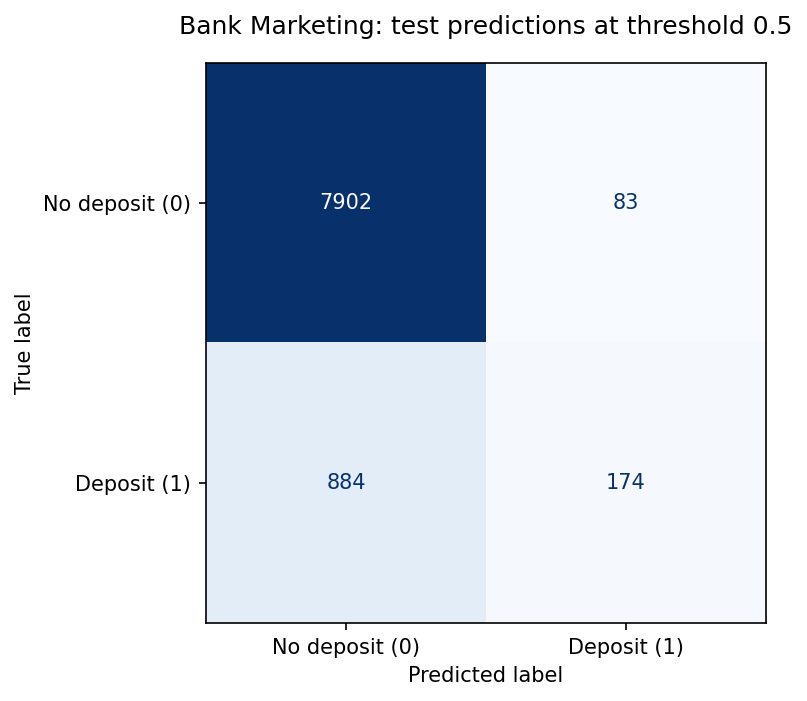

# Bank Marketing — Logistic Regression

A first machine learning project: predict whether a bank client will subscribe
to a term deposit, using information available before a phone call.

The project follows a complete learning experiment: split the data, prepare
features, fit logistic regression, compare it with a constant-probability baseline,
refit on train + validation, evaluate on test, and predict for one client.

**[Open the notebook](bank_marketing.ipynb)** — explanations are in Russian;
code and this README use English names.

## Results

The model, features, and decision threshold were fixed before the original test
evaluation. The following results use threshold **0.5**:

| Split | Method | Accuracy ↑ | Log loss ↓ |
| --- | --- | ---: | ---: |
| Validation | Baseline | 88.299% | 0.360924 |
| Validation | Logistic regression | 89.438% | 0.316309 |
| Test | Baseline | 88.300% | 0.360898 |
| Test | Logistic regression | 89.307% | 0.316915 |

The model improves both metrics over the baseline on this split. However,
it identifies only **174 of 1,058** positive test cases (**16.45% recall**).
High overall accuracy is partly explained by the large share of negative cases.



## Approach

- Dataset: UCI Bank Marketing, specifically **`bank-full.csv`**, 45,211 rows.
- Target: `y`, mapped from `yes/no` to `1/0`.
- Numerical features: `age`, `balance`, `previous`.
- Categorical features: `job`, `education`, `housing`, `loan`, `poutcome`.
- `duration` is excluded because call duration is unavailable before the call.
- Stratified train/validation/test split: approximately 60/20/20, `random_state=42`.
- `DictVectorizer` encodes categories; `StandardScaler` scales only numerical columns.
- Logistic regression: `solver="lbfgs"`, `C=1.0`, `max_iter=100`.
- Preprocessing is fitted on train for validation, then fitted again on train +
  validation for the final model. Test data uses `transform` only.
- Baseline: one probability for every client, equal to the positive share of the
  corresponding training partition. Accuracy uses decisions; log loss uses probabilities.

## Run locally

Tested with **Python 3.12.14**. Use Python 3.12 and run commands from the
repository root. The CSV is included, so the notebook does not download data.

Create a virtual environment:

```bash
python -m venv .venv
```

Activate it on Linux or macOS:

```bash
source .venv/bin/activate
```

Or on Windows PowerShell:

```powershell
.venv\Scripts\Activate.ps1
```

Install dependencies and open the notebook:

```bash
python -m pip install -r requirements.txt
python -m jupyter lab bank_marketing.ipynb
```

Select the environment's Python kernel, then **Restart Kernel and Run All Cells**.
The notebook includes saved results for reading without execution.

For a headless run that replaces saved notebook outputs:

```bash
python -m jupyter nbconvert --to notebook --execute --inplace bank_marketing.ipynb
```

The run also writes `images/test_confusion_matrix.png`.

## Validation

All 11 code cells were executed sequentially in a fresh in-process IPython
session, and the displayed metrics, plot, and single-client prediction were checked.
The validation host blocks socket binding, so launching a separate Jupyter kernel
through `nbconvert --execute` could not be verified there.

## Limitations

- The dataset is ordered by date. A random split is a learning simplification and
  does not establish performance on future campaigns.
- The source mentions repeated contacts with clients. There is no client identifier
  here to verify a client-grouped split.
- Eight features and one algorithm were selected for the exercise. No hyperparameter
  search, threshold optimization, or economic evaluation was performed.
- The test result was already known when this repository was cleaned up. Formatting
  and explanatory diagnostics were added without selecting a different model on test.

## Files

| File | Purpose |
| --- | --- |
| `bank_marketing.ipynb` | Executed experiment, explanations, checks, and one-client prediction |
| `bank-full.csv` | Original UCI dataset used in the experiment |
| `requirements.txt` | Direct dependency versions used for execution |
| `DATASET.md` | Data source, attribution, license, and checksum |
| `images/test_confusion_matrix.png` | Test errors visualized for this README |

## Learning context and credits

Completed while studying [Machine Learning Zoomcamp](https://github.com/DataTalksClub/machine-learning-zoomcamp).

Dataset: Moro, S., Rita, P., & Cortez, P. (2014). *Bank Marketing* [Dataset].
UCI Machine Learning Repository. https://doi.org/10.24432/C5K306.
The dataset is distributed under **CC BY 4.0**; see [DATASET.md](DATASET.md).
